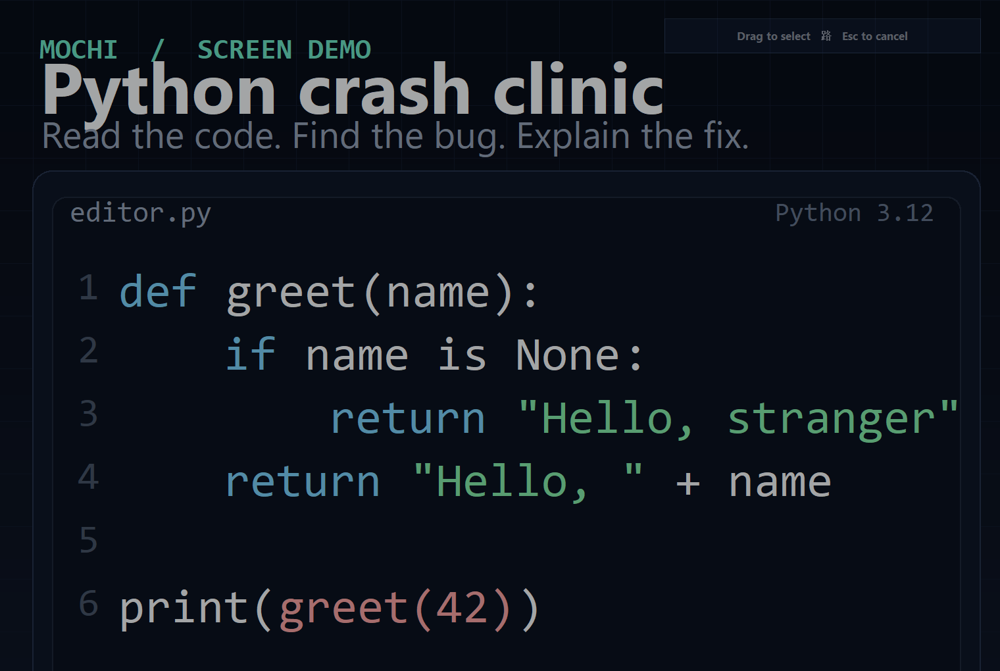
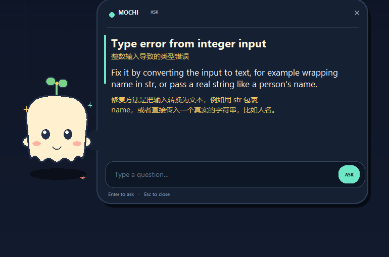

# pet-Lapland v0.2 · 会看屏幕的桌宠

> 框选屏幕上的任意一块，pet-Lapland 用**英语或意大利语**讲给你听，并配中文字幕，答案直接长在桌宠气泡里。

> **v0.1 设计与验收基线**：[Markdown](docs/Mochi-Design-Report.md) · [Word DOCX](docs/Mochi-Design-Report-v0.1.docx)

<p align="center">
  
</p>

## 它是什么

pet-Lapland 不是“又一个聊天桌宠”，而是一个轻量的 **screen explainer（屏幕讲解器）+ 英语口语陪练**：

- `Ctrl+Alt+S` 呼出全屏选区，鼠标拖一个框；
- 截图直接交给 **DeepSeek-V4.1-Flash**（`deepseek-flash`，支持图像输入），不需要先做 OCR；
- 模型返回 2–4 段结构化结果：`headline` + 所选语言口播（`en` 或 `it`）+ 中文翻译 `zh`；
- 桌宠收到首段讲解和中文翻译后就显示字幕并准备朗读，默认使用拉普兰德本地合成音色；
- 支持继续追问，答案仍然回到气泡里；
- 透明、置顶、可拖动，右键菜单可静音、隐藏、退出。

它适合这些场景：读代码/报错、看英文文档和论文图表、理解软件界面、英语听力与表达练习、跨语言工作时的快速解释。

## 快速开始

### 方式一：双击启动（本机已配置好）

双击桌面 **pet-Lapland** 快捷方式，或在项目目录双击 **`run_pet.cmd`**。

启动器优先使用项目的 `.venv`。当前工作区已安装 v0.2 依赖。没有项目环境时，会查找 DSH 自带的 Python：

```
%USERPROFILE%\.dsh\dsh-runtimes\dsh-primary-runtime\dependencies\python\pythonw.exe
```

找不到时回退到系统的 `pythonw` / `python`。

### 方式二：命令行

```powershell
cd E:\Mochi
.\.venv\Scripts\python.exe -m pet.main
```

### 模型密钥

pet-Lapland **不把密钥写进配置文件**，按以下顺序查找：

1. 环境变量 `DEEPSEEK_API_KEY`；
2. DSH 凭据文件：`%DSH_HOME%\.credentials.yaml`，默认 `%USERPROFILE%\.dsh\.credentials.yaml` 中的 `DEEPSEEK_API_KEY`。

你当前已经登录 DSH，所以开箱即用。若换一台机器，设置环境变量即可：

```powershell
setx DEEPSEEK_API_KEY "sk-..."
```

> 模型默认是 `deepseek-flash`（DeepSeek-V4.1-Flash，支持文本+图像）。它和当前 DSH 会话使用同一账号、同一模型，但 pet-Lapland 是独立会话，不共享我们当前这段聊天上下文。

## 快捷键

| 操作 | 快捷键 |
|---|---|
| 框选屏幕并提问 | `Ctrl+Alt+S` |
| 打开/关闭追问输入框 | `Ctrl+Alt+Space` |
| 隐藏/显示桌宠 | `Ctrl+Alt+H` |
| 退出 | `Ctrl+Alt+Q` |
| 关闭输入框 / 停止朗读 | `Esc` |
| 停止朗读 / 打开追问 | 单击桌宠 |
| 移动桌宠 | 按住桌宠拖动 |
| 更多操作 | 右键桌宠或气泡 |
| 语音提问或追问 | 按住气泡顶部「按住说话」，说完松开；录音或识别时按 Esc 可取消 |

如果某个热键被其他软件占用，pet-Lapland 会在气泡底部提示，右键菜单里的 **Capture region** / **Ask about this screen** 仍然可用。具体冲突会写入 `pet.log`。

### 按住说话

按下「按住说话」会停止当前朗读并打开 Windows 默认麦克风。松开后麦克风关闭，Whisper 在本机自动识别输入语言；识别出的文字显示在气泡里，并作为本轮问题发送。已有框选画面时会继续基于该画面追问。回答沿用所选的英配或意配，并显示中文字幕。麦克风录音仅在内存中处理。隐藏桌宠、取消录音或退出都会释放麦克风。

本机已经安装识别模型。新环境安装项目依赖后运行 `.\.venv\Scripts\python.exe tools\setup_voice_input.py`，下载模型到 `models/whisper-base/`。

## 交互流程

1. 按 `Ctrl+Alt+S`，屏幕变暗，拖一个矩形；
2. 在预览中检查接收方和选区，拖动可添加黑色遮盖，也可撤销。点「确认发送」后，pet-Lapland 把处理后的图像压成 JPEG 发给模型。按 Esc 或点「取消」会丢弃这次选区；
3. 模型按固定 JSON schema 流式返回所选语言口播和中文翻译，首段完整时即显示；
4. pet-Lapland 用所选声音逐段合成并播放。所选服务暂时不可用时，本轮尝试使用同语种的系统音色，随后可降级为字幕；
5. 每段开始播放时，气泡同步切换所选语言 + 中文字幕；
6. 点桌宠或按 `Ctrl+Alt+Space`，可以基于同一张截图继续追问；
7. 右键「完整讲解记录」可复制当前选区的全部双语讲解和追问。确认新选区后开始新的记录。
8. 右键「对话历史…」可回看已保存的选区和追问。列表按最近更新时间排列，搜索框支持问题、回答中的文字或日期（如 `2026-11-22`）。选中一项可阅读、复制或删除整段对话。

<p align="center">
  
</p>

<p align="center">
  
</p>

## 设计取舍

- **直接视觉理解，而不是 OCR**：少一层识别误差，能同时理解代码、UI、图表和自然图像；代价是模型可能看错小字，重要内容建议框小一点。
- **口播与中文字幕分开生成**：英语使用 `en`，意大利语使用 `it`；`zh` 是同一句的翻译，负责“看懂”。
- **按段合成、按段播放**：字幕能跟着 WAV 的真实时长走，而不是拍脑袋计时。
- **Python + Tkinter，而不是 Electron**：透明置顶窗、全局热键、SAPI、winsound 都是 Windows 原生能力，MVP 不需要背一个浏览器内核。
- **密钥复用 DSH**：不复制、不落盘，减少密钥泄露面。

## 隐私

- 按下框选快捷键或选择右键菜单里的 Capture region 后，完成选区才会截屏。按 Esc 取消框选会直接返回。
- 默认截图只在内存中。设置 `"save_captures": true` 后会在发送时把最终图片保存到 `captures/`，遮盖同样生效。追问复用同一张处理后的图片。
- 从此版本起，默认把已完成的问题、双语回答和时间保存在当前 Windows 用户的 `%LOCALAPPDATA%\Mochi\history.sqlite3`。在设置中取消「在本机保存新对话的文字记录」可暂停保存，已有记录仍可查看或删除。浏览历史仅访问本机数据库。
- 使用 lapland 或 SAPI 时，合成在本机完成。选择 Edge 或 Azure 时，微软语音服务会收到所选语言的口播文本。语音文件临时存放在 `cache/`，播放完成或中断后清理。
- 截图会发送到 `https://api.deepseek.com` 的视觉模型；请遵守 DeepSeek 的数据政策，不要框选密码、私钥、身份证等敏感内容。
- `pet.log` 只记录模型、耗时、token 用量和错误，不记录密钥、截图或完整对话。
- `config.json` 只保存窗口位置、静音状态等偏好。

## 配置

右键桌宠打开「设置…」，可修改视觉模型、语音服务、音色、语速、静音和四个全局热键。预览确认和首段流式输出默认开启。保存后设置立即生效，热键注册冲突会显示在气泡底部。

| 语音服务 | 使用条件 |
|---|---|
| `lapland`（默认） | 本机 PocketTTS，英语和意大利语各有独立模型及角色音色 |
| `sapi` | Windows 已安装所选语言的 SAPI 声音 |
| `edge` | 安装项目依赖并联网。默认音色为 `en-US-JennyNeural` |
| `azure` | 启动前设置 Azure 语音资源的环境变量 `SPEECH_KEY` 和 `SPEECH_REGION`，例如区域 `eastus` |

### 拉普兰德的英语和意大利语配音

右键打开「设置…」，语音服务选 `lapland`，在「回答和朗读语言」里选择英语或意大利语。保存后从下一条提问起生效；每次只朗读所选语言，中文字幕同步显示。

两种语言分别使用社区发布的 PocketTTS 英语和意大利语 ONNX 权重，在本机独立适配。英语适配会编码目录中全部 35 段完整录音，用全库统计校准每段的音色特征，并保留各段的时间变化。合成新话时，按问句或陈述、词数和停顿选取参考；很短的原句会搭配一段连贯对白。意大利语以意配「交谈 3」保持基础音色，用「交谈 1」和「完成高难行动」分别适配反问和强调句。短小的称呼会和紧邻的句子一起合成。[基础模型](https://huggingface.co/kyutai/pocket-tts) · [ONNX 导出](https://huggingface.co/KevinAHM/pocket-tts-onnx) · [角色语料](https://huggingface.co/datasets/None1145/Lappland)

合成英语新句时会在长引入语、转折及反问之间留出停顿。铺垫优先参考原声里偏低、偏慢的说法，情绪转折会参考音域较宽、词速较快的说法。效果过平或过高时，合成器可多生成一次，在时长相近的读法里选取合适的一条，这可能增加合成时间。新对白里独立成句的原版台词也能使用对应录音，包括轻笑和狂笑。

角色对白提示词保存在 [dsh-persona.txt](assets/lapland/dsh-persona.txt)，可以复制给 DSH 单独使用。桌宠会在每次请求时读取同一文件，另加所选口播语言、双语字幕和 JSON 格式规则。

英语支持 35 条游戏原声。完整口播片段与台词词序一致时，默认语速直接播放原录音。其余片段用英配参考音色合成。可以在英语模式说「来一句原版问候」试听。原声目录来自[角色录音](https://huggingface.co/datasets/None1145/Lappland/tree/79d7bd1daf455d6a8b7c2c71b24618e31f5d4ba4/Audio/English)，台词使用[游戏英文数据](https://github.com/Kengxxiao/ArknightsGameData_YoStar/blob/57010cb5b2afea112cae57daa756b58676ba6850/en_US/gamedata/excel/charword_table.json)。

朗读的语调由参考录音和模型直接生成。安装脚本为两种语言分别下载全精度语音生成模型及波形解码器。英语使用 8 步采样，意大利语使用 4 步。输出时检查 6 kHz 和 7.2 kHz 附近是否持续出现窄带突起，仅对达到阈值的频带轻微衰减，最多 5 dB。

本机已就绪。新环境安装项目依赖后，可运行 `.\.venv\Scripts\python.exe tools\setup_lapland_voice.py` 下载固定版本的模型和语料并重建两套音色。模型位于 `models/pocket-tts/`，角色参考录音、适配参数和试听文件位于 `assets/lapland/voice/`。

首次启动会生成 `config.json`：

```json
{
  "model": "deepseek-flash",
  "api_base": "https://api.deepseek.com",
  "voice": "Zira",
  "speech_provider": "lapland",
  "speech_language": "en",
  "neural_voice": "en-US-JennyNeural",
  "confirm_capture": true,
  "stream": true,
  "rate": 0,
  "muted": false,
  "max_image_side": 1600,
  "jpeg_quality": 88,
  "save_captures": false,
  "reasoning_effort": "low",
  "hotkeys": {
    "capture": "ctrl+alt+s",
    "ask": "ctrl+alt+space",
    "toggle": "ctrl+alt+h",
    "quit": "ctrl+alt+q"
  },
  "window": {"x": 1814, "y": 1120}
}
```

| 字段 | 说明 |
|---|---|
| `model` | 默认 `deepseek-flash`；换成纯文本模型会失去读图能力 |
| `voice` | SAPI 声音名片段，默认 `Zira`；找不到会回退到第一个同语种声音 |
| `rate` | 语速，`-10..10` |
| `max_image_side` | 截图最长边，越大越清晰也越贵 |
| `jpeg_quality` | 截图压缩质量 |
| `save_captures` | 是否保存截图到 `captures/`，默认关闭 |
| `reasoning_effort` | `low` 降低延迟；可改 `high` / `max` |

## 目录结构

```
E:\Mochi
├── pet\
│   ├── main.py           # 入口、日志、DPI
│   ├── app.py            # 透明窗、气泡、状态机、动画
│   ├── screen.py         # 全屏选区、虚拟屏幕、截图裁切
│   ├── llm.py            # DeepSeek 视觉请求、JSON 解析
│   ├── speech.py         # SAPI WAV 合成、顺序播放、字幕计时
│   ├── neural_worker.py  # Edge / Azure 英文神经语音合成
│   ├── dialogs.py        # 发送前预览、遮盖与设置
│   ├── hotkeys.py        # RegisterHotKey 全局热键线程
│   ├── config.py         # 配置与 DSH 密钥发现
│   └── tts_worker.ps1    # Windows PowerShell + SAPI 合成
├── assets\               # 演示截图
├── run_pet.cmd           # 双击启动
├── config.json           # 本地偏好（不含密钥）
├── pet.log               # 运行日志
└── cache\                # 临时 WAV，自动清理
```

## 依赖

- Windows 10/11；
- Python 3.10+（本机用 DSH 自带 3.12）；
- Pillow、edge-tts 和 miniaudio。新机器可在项目目录执行 `python -m venv .venv`，再执行 `.\.venv\Scripts\python.exe -m pip install -r requirements.txt`；
- 可访问 `api.deepseek.com`；
- 已安装至少一个英文 SAPI 声音（本机为 Microsoft Zira Desktop）。

## 常见问题

**按 `Ctrl+Alt+S` 没反应？**
先看 `pet.log` 里有没有 `failed to register`。热键被占用时用右键菜单；也确认没有以管理员身份运行的窗口抢焦点（Windows 的 UIPI 会阻止普通进程给高权限窗口发快捷键）。

**有字幕但没声音？**
检查系统默认播放设备、音量，以及 `voice` 是否匹配已安装的 SAPI 声音。语音失败时 pet-Lapland 仍会按预估时长推进字幕，不会卡死。

**模型报 401 / 402 / 429？**
分别是密钥无效、余额不足、请求过快。pet-Lapland 会在气泡里给出简短中英文提示，详细信息在 `pet.log`。

**框选后没有出现桌宠？**
正常情况下桌宠会先变全透明、避免截到自己，然后恢复。如果异常，按 `Ctrl+Alt+H` 或右键菜单重新显示。

**字体/窗口太小？**
对话框展开时最大为 960×430 物理像素；在高 DPI 屏幕上会显得紧凑。后续版本会加 UI 缩放配置。

## 已知限制

- 云语音的延迟受网络影响；本地角色语音的合成速度由 CPU 决定。
- 模型可能看错很小的字或行号；重要代码建议只框选相关几行。
- 受保护内容（DRM、部分全屏游戏、UAC 安全桌面）可能截成黑屏。
- 目前是单机 MVP：没有安装包、没有开机自启、没有系统托盘、没有多轮长期记忆。
- 拉普兰德使用七张透明表情图。接到问题时歪头，随后托腮思索，等待回复时显示省略号，较久时短暂抱臂。首段回答到达后微笑，讲解完成时比耶，遇到错误时冒汗。

## 对话框、字幕与记忆

启动时只显示角色。单击角色可展开对话框，提问快捷键会直接打开输入框，提交框选后会展开讲解。点对话框右上角的 × 即可收起，角色仍在桌面。回答结束后，鼠标离开面板且空闲约 30 秒也会自动收起。打字、录音、朗读或将鼠标停在字幕上阅读期间，面板保持展开。

对话框使用拉普兰德「典雅噩兆」的淡化立绘。字幕上行显示当前所选的英语或意大利语，下行显示中文。长句会分页，朗读时按该段音频的时长自动翻页，也可以点字幕下方的左右箭头。右键打开「对话历史」可以阅读已保存的完整双语回答。[立绘来源](https://github.com/Aceship/Arknight-Images/blob/main/characters/char_140_whitew_boc%231.png)

按住「按住说话」开始录音，松开后在本机转写并提交。按 Esc 可取消。要留下一条长期记忆，可以说「请记住，我喜欢暖灰色」，也可以在右键菜单的「长期记忆」里添加、查看和删除。

开启本地对话记录后，下次启动会接上最近话题的三轮文字。发送追问时，每轮回答只带一份文字，完整的双语记录仍保存在本机。较早的对话累计到六轮或约 800 个估算 token 后，桌宠会在后台用已配置的模型合并上次摘要和新增内容，分别记录主要事项、未完成事项和次要细节。摘要请求会单独消耗 token，实际用量取决于模型。生成失败会保留原记录和上一次进度，在后续对话重试。[LangMem 滚动摘要设计](https://github.com/langchain-ai/langmem/blob/main/src/langmem/short_term/summarization.py)

## v0.2 验收

- 连续 10 次在本机 Windows 桌面上框选测试色块，核对裁切像素、遮盖区域、确认前请求数以及追问复用的图片。测试使用本地模拟模型，结束后检查了请求、朗读和热键线程是否退出。
- 合成水果清单图的真实视觉请求返回了双语讲解，追问正确算出水果总数。调整首段输出顺序后，三次后台请求从发出到收到首段分别耗时 1.53、1.12、1.97 秒；这些数据不含选区操作、界面刷新或语音合成。
- 本机已验证 SAPI 和 Edge 生成有效 WAV。Azure 已验证请求格式和缺少凭据时的本地回退，真实 Azure 合成需要配置语音资源。

运行 `.\.venv\Scripts\python.exe -m unittest discover -s tests -v` 可复验本地测试。完整测试会打开测试窗口和框选遮罩。只做后台检查时，可分别追加 `-k StreamTest` 和 `-k VoiceTest`。

## 下一步

- Live2D / Spine 角色与口型同步；
- 打包成 DSH 插件或独立安装包；
- 局部放大；
- 本地 OCR 作为小字兜底。

## 相关项目

调研时参考了这些相邻项目（据各自 README/市场页描述）：

- [dsh-pet-indesktop](https://github.com/MerZlin/dsh-pet-indesktop)：把桌宠搬到 Windows/Linux/macOS 的 DSH 社区插件，带自言自语气泡。
- [dolphin-pet-plugin](https://dshplugin.online/plugins/bo961386926--dolphin-pet-plugin)：DSH 界面内的桌宠 UI 插件。
- [moepet](https://github.com/zhuge-Tom/moepet)：Windows Live2D 桌宠，模型对话、本地语音、屏幕感知、独立记忆。
- [AI-Desktop-Pet](https://github.com/ruguo0119/AI-Desktop-Pet)：陪聊、语音/文字输入、长期记忆、视觉与 TTS。
- [Mascot_ai](https://github.com/mohitantil/Mascot_ai)：陪用户处理屏幕工作的 on-screen pet。
- [Open-LLM-VTuber](https://docs.llmvtuber.com/docs/intro/)：开源语音陪伴/虚拟形象方向。

pet-Lapland 的差异点是：**热键框选 + 直接视觉理解 + 可切换的英／意口播 + 中文字幕 + 桌宠内出结果** 这一整套组合，而不是泛化的“AI 陪聊”。

---

MIT License.
