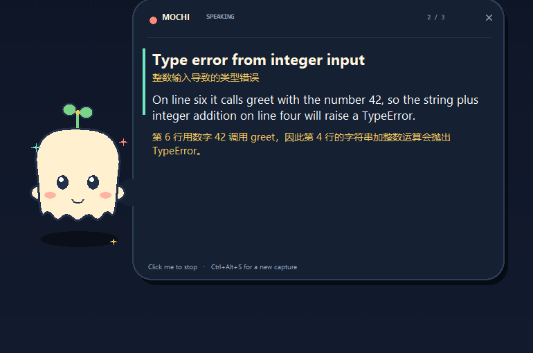
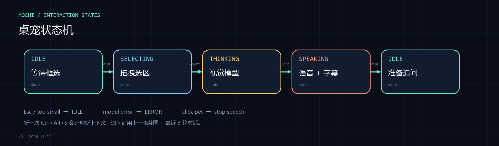
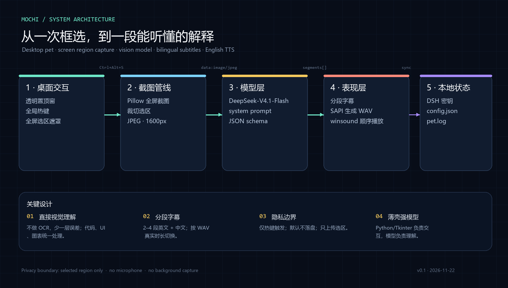
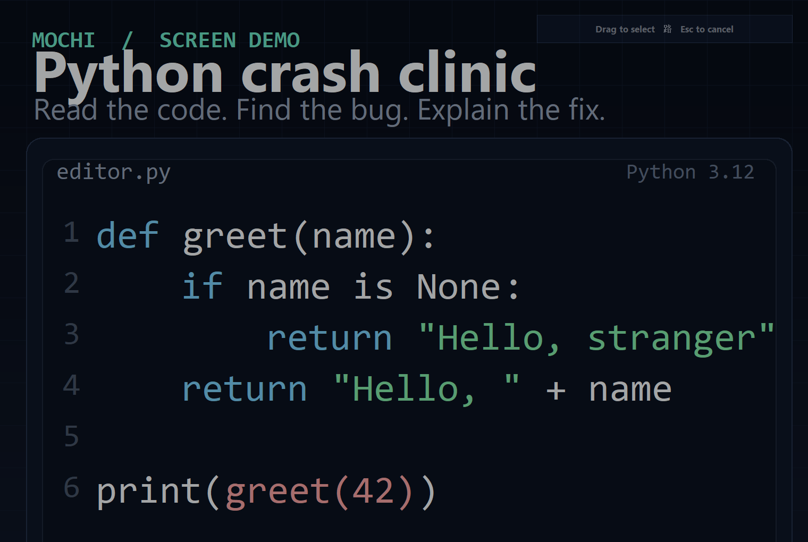
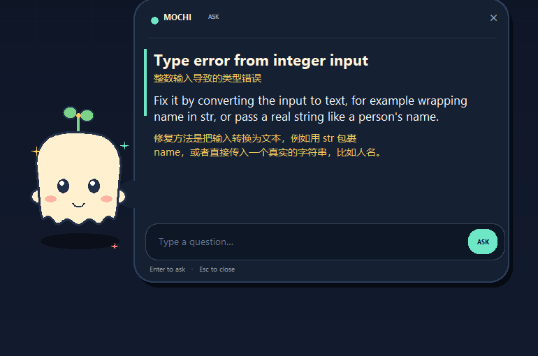

# Mochi · 会看屏幕的桌宠
## 详细设计报告（Markdown 交付版）

> **项目区**：`E:\Mochi`  
> **版本**：v0.1 / MVP  
> **日期**：2026-11-22  
> **状态**：设计已验证，开发已暂停，等待评审  
> **接入模型**：`deepseek-flash`（DeepSeek-V4.1-Flash，text + image）  
> **一句话**：框选一块屏幕，Mochi 用纯英文讲给你听，中英字幕帮你确认。



---

## 0. 交付摘要

### 0.1 结论

**这个设计可行，而且 MVP 已经跑通。**

真正的差异点不是“做一个桌宠”，而是把下面这条链路做顺：

> 全局热键 → 鼠标框选屏幕 → 截图直接给视觉模型 → 纯英文口播 + 中英字幕 → 结果回到桌宠 → 可继续追问

它更像一个 **screen explainer（屏幕讲解器）+ 英语口语陪练**，而不是“又一个 AI 聊天宠物”。

### 0.2 实测数字

| 指标 | 实测 / 目标 | 含义 |
|---|---|---|
| 框选到首段字幕 | 约 3 s | 模型 2.2–2.4 s + 本地处理 |
| 视觉请求耗时 | 2.19–2.38 s | 约 1470×790 选区，JPEG 1600 px，`reasoning_effort=low` |
| 单次 prompt | 约 1,080–1,137 tokens | 图片 token 占主要部分 |
| 回答结构 | 3–4 段，每段英文 + 中文 | 适配 3 秒注意力窗口 |
| 英文语音合成 | 3 段约 0.57 s | SAPI / Zira，本地离线 |
| 密钥落盘 | 0 份 | 从 DSH 凭据或环境变量读取 |

### 0.3 当前交付物

| 文件 | 说明 |
|---|---|
| `E:\Mochi\pet\` | 可运行的 Python/Tkinter MVP |
| `E:\Mochi\run_pet.cmd` | 双击启动 |
| `E:\Mochi\README.md` | 使用说明、隐私说明、故障排查 |
| `E:\Mochi\DESIGN.md` | 设计评估精简版 |
| `E:\Mochi\docs\Mochi-Design-Report.md` | 本文件 |
| `E:\Mochi\docs\Mochi-Design-Report-v0.1.docx` | 排版版详细报告（31 页） |
| `E:\Mochi\assets\` | 演示截图、架构图、状态机 |

> 说明：接到“暂停开发、先出设计报告”的要求后，未继续增加功能；当前 MVP 保持可运行状态。

---

## 1. 背景与问题定义

### 1.1 三个趋势交汇

1. **屏幕成为主要工作界面**：代码、文档、报错、图表、设计稿都在屏幕上，理解成本高。
2. **视觉模型足够快、足够便宜**：一张约 1470×790 的截图，端到端 2 秒级返回，接近“随手一问”。
3. **桌宠从装饰变成交互入口**：常驻、低打扰、有角色感，适合承载轻量、随时发生的交互。

这三件事单独看都不新；叠在一起，就出现了一个具体机会：用户不离开当前屏幕，也不组织完整提问，只要框一块区域，就能得到一段用英文讲清楚的解释。

### 1.2 核心问题

> 当用户在看英文内容 / 代码 / 报错 / UI 时，理解成本高；切换浏览器、翻译工具或聊天窗口会打断注意力。

现有产品大多只解决其中一段：

- 桌宠解决“陪伴 / 装饰”，不解决“这块屏幕是什么意思”；
- 截图/OCR 工具解决“识别 / 翻译”，但不常驻、不做逐段讲解；
- 聊天机器人能解释，但需要用户切窗口、上传图片、重新组织问题。

Mochi 要做的是一条连续动作：**选区 → 直接视觉理解 → 英文口播 → 中文字幕 → 桌宠内追问**。

### 1.3 设计目标

| 目标 | 可度量标准 | MVP 状态 |
|---|---|---|
| 低打扰 | 不离开当前窗口；不强制跳聊天页；不后台截屏 | 已实现：透明置顶气泡 + 显式热键 |
| 快 | 框选到首段字幕 P50 < 3 s | 实测约 3 s |
| 听得懂 | 英文口播自然、可逐段打断；中文字幕忠实 | SAPI 清晰但偏机械；字幕同步已实现 |
| 看得准 | 代码/报错/UI 的关键信息解释正确 | 常见场景可用；小字/行号仍需复核 |
| 可信任 | 用户清楚“截了什么、发给谁” | 仅热键触发；默认不落盘；仅选区上传 |
| 可扩展 | 模型、语音、角色可替换 | `llm.py` / `speech.py` 已隔离 |

### 1.4 非目标

- 不做 7×24 录屏、后台监听或“主动观察用户在干什么”；
- 不做长期记忆和用户画像；追问只保留最近 3 轮，重启即清空；
- 不做通用情感陪伴、角色养成或游戏化；
- MVP 不追求 Live2D/3D 级角色表现，先用可替换的 Canvas 小幽灵验证交互。

---

## 2. 市场与竞品调研

### 2.1 调研方法

- 在 GitHub 搜索 `desktop pet`、`AI desktop companion`、`screen perception`、`Live2D pet` 等关键词，查看 README 与功能列表；
- 查看 DSH 插件索引/市场页面（dshhub.org、dshplugin.online、dsh.pub 等）中的桌宠类插件；
- 用公开搜索摘要交叉确认项目定位；未逐一安装所有竞品，功能对比以“项目自述”为准；
- 调研时间：2026-11-22。生态变化快，结论有时效性。

### 2.2 竞品矩阵

| 项目 | 形态 | 已有能力（据项目描述） | 与本设计的差距 |
|---|---|---|---|
| [dsh-pet-indesktop](https://github.com/MerZlin/dsh-pet-indesktop) | DSH 社区桌宠，Win/Linux/macOS | 桌面常驻、蓝色大鱼、自言自语气泡、额外交互 | 未见“框选屏幕 → 视觉讲解 → 英文语音/双语字幕”主链路 |
| [dolphin-pet-plugin](https://dshplugin.online/plugins/bo961386926--dolphin-pet-plugin) | DSH 界面内 UI 插件 | 在 DSH 页面里养一只海豚 | 是界面内宠物，不覆盖桌面，不做选区截屏 |
| [moepet](https://github.com/zhuge-Tom/moepet) | Windows Live2D 桌宠 | 模型对话、按角色本地语音、屏幕感知、独立记忆 | 最接近；偏中文陪伴/Live2D，未突出纯英文口播 + 中英字幕 |
| [AI-Desktop-Pet](https://github.com/ruguo0119/AI-Desktop-Pet) | 开源 AI 桌宠 | 语音/文字陪聊、长期记忆、视觉、TTS | 能力重叠，但核心交互是聊天，不是“划一块屏幕让它讲” |
| [Mascot_ai](https://github.com/mohitantil/Mascot_ai) | on-screen pet | 陪用户处理屏幕工作、答疑 | 方向接近，但双语语音链路与产品化未验证 |
| [Open-LLM-VTuber](https://docs.llmvtuber.com/docs/intro/) | 语音陪伴/虚拟形象 | 语音对话、角色形象、桌宠模式 | 强在陪伴与语音，屏幕选区讲解不是重点 |
| [Live2DPet](https://github.com/x380kkm/Live2DPet) | Live2D + VOICEVOX | AI 对话、日语 TTS | 语音与形象强，英语讲解与字幕不是重点 |

### 2.3 竞品启示

- **需求被验证过**：桌宠、屏幕感知、语音陪伴都有人做，用户不需要被教育“为什么要有桌宠”。
- **供给是分层的**：偏陪伴的（moepet、Open-LLM-VTuber）、偏界面内的（dolphin-pet-plugin）、偏开发者的（AI-Desktop-Pet）。
- **“英语讲解”是空位**：大多数项目默认中文或日语交互；英语口播 + 中文字幕的学习型定位很少被做深。
- **“选区”是差异化动作**：整屏截图/OCR 工具很多，但“鼠标划一块 + 桌宠内讲解”的动作更轻、更可控。

### 2.4 差异化定位

> **一个会看屏幕的英语讲解桌宠**：框选 → 直接视觉理解 → 纯英文口播 → 中英混排字幕 → 桌宠内追问。

### 2.5 竞争风险

- **现有桌宠加功能**：moepet 这类项目可以补上“英文讲解”；速度、场景准确率和语音质量很关键，单靠“有桌宠”不构成壁垒。
- **系统级工具**：Windows 截图工具、翻译软件、浏览器侧边栏都能做“截图解释”，但它们不常驻、没有角色感、也不做逐段字幕。
- **模型能力商品化**：视觉理解会越来越便宜；壁垒在场景数据、prompt/评测、交互细节和用户信任。

---

## 3. 用户与场景

### 3.1 目标用户

| Persona | 典型行为 | 核心诉求 |
|---|---|---|
| 英文技术读者 | 读英文文档、论文、GitHub issue；遇到长句/术语切浏览器 | 别打断我；告诉我这段在说什么、下一步做什么 |
| 开发者/运维 | 看报错、日志、代码 review、dashboard | 快速定位错误原因；最好给一个可执行的修复建议 |
| 英语学习者 | 看英文视频/文章/UI，想练听力 | 英文讲解自然；中文字幕能对照；可以重复听 |
| 跨境协作者 | 收到英文截图/设计稿/表格，需要快速理解 | 不想逐字翻译；想知道重点和行动项 |

### 3.2 Jobs to be Done

| 情境 | 用户想完成的事 | Mochi 的回应 |
|---|---|---|
| 看到一段陌生代码 | 这段代码干什么？有没有 bug？ | 解释意图 + 指出风险 + 给修复方向 |
| 看到英文报错 | 为什么报错？怎么修？ | 定位原因 + 给具体修改 |
| 看到英文 UI/文档 | 这页在说什么？我该点哪？ | 概括目的 + 指出下一步 |
| 看到论文图表 | 这个图说明什么？ | 解释坐标/趋势/结论，不逐像素描述 |
| 想练英语听力 | 用英文讲，别用中文 | 纯英文口播 + 中文字幕对照 |

### 3.3 核心用户旅程

| 阶段 | 用户动作 | 系统反馈 | 情绪/风险 |
|---|---|---|---|
| 触发 | 按 `Ctrl+Alt+S` | 屏幕变暗，出现“Drag to select” | 担心误触/截到隐私 |
| 选择 | 拖一个矩形 | 实时显示尺寸；Esc 可取消 | 手抖选偏；区域太小 |
| 等待 | 松开鼠标 | 桌宠 LOOKING + 省略号 | 2–4 秒空白，怀疑卡住 |
| 理解 | 听英文，扫中文字幕 | 逐段高亮，可点桌宠停止 | 语速太快/声音机械 |
| 追问 | `Ctrl+Alt+Space` 输入问题 | 沿用上一张截图和上下文 | 输入焦点/热键冲突 |
| 结束 | 继续工作或再框一块 | READY，提示下一次操作 | 忘记怎么再触发 |

### 3.4 场景优先级

| 优先级 | 场景 | 理由 |
|---|---|---|
| P0 | 代码/报错解释 | 高频、痛点强、模型有优势；最容易验证准确性 |
| P0 | 英文文档/UI 解释 | 与“英语讲解”定位最契合；截图即可，不需要复杂集成 |
| P1 | 论文图表/表格 | 视觉理解有价值，但准确性要求更高，需要人工复核 |
| P1 | 英语听力练习 | 差异化强；依赖更自然的语音，SAPI 只是 MVP 兜底 |
| P2 | 设计稿/图片描述 | 容易演示，但离“工作流”较远，先不作为核心 |

---

## 4. 产品方案

### 4.1 价值主张

> **For 需要快速理解屏幕内容的英文读者**  
> Mochi 是一个常驻桌面的小助手。框选任意区域，它用英文讲清楚这是什么、为什么重要、下一步做什么，并用中文字幕帮你确认理解——不用离开当前窗口。

### 4.2 功能范围（MoSCoW）

| 优先级 | 功能 | 说明 | 状态 |
|---|---|---|---|
| Must | 全局热键框选 | `Ctrl+Alt+S`；Esc 取消；显示尺寸 | 已完成 |
| Must | 截图 → 视觉模型 | Pillow 裁切、JPEG 压缩、base64 上传 | 已完成 |
| Must | 英文口播 + 中文字幕 | 2–4 段，逐段同步 | 已完成 |
| Must | 桌宠内展示 | 透明置顶气泡，不跳窗 | 已完成 |
| Must | 停止/追问 | 点桌宠停止；`Ctrl+Alt+Space` 追问 | 已完成 |
| Should | 静音/隐藏/退出 | 右键菜单；快捷键 | 已完成 |
| Should | 错误提示 | 401/402/429/超时/无声音 | 已完成 |
| Should | 密钥复用 DSH | 不落盘、不复制 | 已完成 |
| Could | 发送前预览 | 降低隐私风险，但多一步 | 未做 |
| Could | Edge/Azure 神经语音 | 更自然的英文 | 未做 |
| Could | 流式首段 | 进一步降低首字延迟 | 未做 |
| Won't | 长期记忆/用户画像 | MVP 明确不做 | — |
| Won't | 全屏录屏/后台监听 | 隐私与定位不允许 | — |
| Won't | Live2D 角色 | 先验证交互，再换皮 | — |

### 4.3 核心流程

1. 用户按 `Ctrl+Alt+S`；桌宠窗口变为全透明（仍 mapped，避免截到自己）。
2. 全屏 Toplevel 遮罩出现，显示“Drag to select · Esc to cancel”。
3. 鼠标拖拽；实时显示选区尺寸；松开后销毁遮罩。
4. 等待 130 ms 让遮罩完全消失，再抓取虚拟屏幕并裁切选区。
5. 截图转 RGB、最长边压到 1600 px、JPEG 质量 88、base64。
6. 请求 DeepSeek：system prompt 约束“英文口播 + 中文翻译 + JSON schema”。
7. 解析 `segments[]`；先显示第一段，生成所有 WAV。
8. 逐段播放 WAV；每段开始时切换字幕和 `1 / n` 进度。
9. 播放结束显示 READY；可点桌宠停止，或按 `Ctrl+Alt+Space` 追问。
10. 追问沿用上一张截图 + 最近 3 轮对话；新框选清空上下文。



### 4.4 快捷键与操作

| 操作 | 快捷键/手势 | 备注 |
|---|---|---|
| 框选屏幕 | `Ctrl+Alt+S` | 被占用时用右键菜单 |
| 打开/关闭追问 | `Ctrl+Alt+Space` | 输入框自动聚焦 |
| 隐藏/显示 | `Ctrl+Alt+H` | 隐藏后仍可用热键唤回 |
| 退出 | `Ctrl+Alt+Q` | 无确认，直接退出 |
| 停止朗读/关输入 | `Esc` | 优先关输入，再停语音 |
| 停止/追问 | 单击桌宠 | 拖动超过 4 px 视为移动 |
| 移动 | 按住桌宠拖动 | 位置写入 `config.json` |
| 更多 | 右键桌宠/气泡 | Capture / Ask / Stop / Mute / Hide / Quit |

### 4.5 字幕与语音规范

- `en`：自然口语，14–28 词/段，2–4 段，总口播 < 90 词；不含中文、Markdown、emoji、代码围栏。
- `zh`：与 `en` 一一对应的忠实翻译，不是摘要；技术术语可保留英文。
- `headline_en` ≤ 6 词；`headline_zh` ≤ 16 字；用于气泡顶部标题。
- TTS 只读 `en`，并把 `str`、`f-string`、`TypeError` 等代码词替换成可发音形式；中文字幕不参与朗读。
- 每段单独合成 WAV，按 `wave` 真实时长推进；语音失败时按词数估算时长，字幕不阻塞。

### 4.6 追问与上下文

追问不是“重新开一个聊天”，而是“围绕同一块屏幕继续问”。实现上保留上一张截图和最近 3 轮 Q/A：当前问题 + 上一张图 + 历史 JSON 一起发给模型；system prompt 明确要求“结合截图和先前对话直接回答”。新一次框选会清空历史，避免不同屏幕内容串味。

### 4.7 错误与边界状态

| 状态 | 触发 | 用户看到什么 | 系统行为 |
|---|---|---|---|
| NO KEY | 找不到 `DEEPSEEK_API_KEY` / DSH 凭据 | “I need a key.” + 中英说明 | 不发起请求；提示设置方法 |
| HMM | 模型 401/402/429/超时/解析失败 | “That didn't work.” + 简短原因 | 保留上一张截图，可重试 |
| LOOKING | 模型请求中 | 动态省略号 | 禁止重复截屏；可 Esc 停语音 |
| SPEAKING | TTS 播放中 | 逐段字幕 + 进度 | 点桌宠/Esc 停止；旧音频 token 失效 |
| READY | 播放完成 | 最后一段字幕 + 追问提示 | 可继续追问或新框选 |
| CANCELLED | Esc / 选区太小 | 恢复 IDLE | 不调用模型，不发送任何数据 |

---

## 5. 技术架构

### 5.1 总体架构



Mochi 采用“**薄壳 + 强模型**”的结构：客户端只负责窗口、热键、截屏、字幕和音频，理解与表达交给模型；模块之间用明确的 JSON 契约和事件队列隔离，便于替换模型、语音或角色。

### 5.2 模块职责

| 模块 | 文件 | 职责 | 关键实现 |
|---|---|---|---|
| 入口 | `pet/main.py` | DPI 感知、日志、加载配置、启动 App | `SetProcessDpiAwareness(2)` |
| 桌宠 UI | `pet/app.py` | 透明窗、气泡、字幕、输入、动画、状态机 | Tkinter Canvas + 事件队列 |
| 选区/截屏 | `pet/screen.py` | 全屏遮罩、拖拽、虚拟屏幕坐标、裁切 | Toplevel + Pillow `ImageGrab` |
| 模型适配 | `pet/llm.py` | 请求、重试、JSON 解析、错误映射 | `urllib` + `response_format=json_object` |
| 语音 | `pet/speech.py` | 分段合成、顺序播放、字幕计时、TTS 清洗 | SAPI WAV + `winsound` |
| 热键 | `pet/hotkeys.py` | `RegisterHotKey`、消息循环、事件投递 | 独立线程 + `GetMessageW` |
| 配置 | `pet/config.py` | 默认值、合并、密钥发现、缓存清理 | JSON + DSH YAML 正则 |
| TTS worker | `pet/tts_worker.ps1` | PowerShell + SAPI 生成 WAV | `SpFileStream` / `SpVoice` |

### 5.3 关键时序

| # | 调用方 | 动作 | 结果 |
|---|---|---|---|
| 1 | 用户 | 按 `Ctrl+Alt+S` | `WM_HOTKEY` 进入 hotkey 线程 |
| 2 | `hotkeys.py` | 投递 `('hotkey','capture')` | 主线程 `begin_capture()` |
| 3 | `app.py` | root alpha=0，隐藏输入 | 桌宠不可见但保持 mapped |
| 4 | `screen.py` | 创建全屏遮罩，拖拽 | 返回绝对 bbox |
| 5 | `screen.py` | 销毁遮罩，等待 130 ms | 避免遮罩进入截图 |
| 6 | `screen.py` | `ImageGrab` 全屏，裁切 | `PIL.Image`（RGB） |
| 7 | `app.py` | 恢复 alpha=1，显示 LOOKING | 用户看到反馈 |
| 8 | `llm.py` | 编码 JPEG，发 `/chat/completions` | 返回 content JSON |
| 9 | `llm.py` | 解析、清洗、截断 | headline + `segments[]` |
| 10 | `speech.py` | 逐段生成 WAV | `Paths[]` |
| 11 | `app.py` | 事件驱动字幕切换 | `1/n → n/n` |
| 12 | `app.py` | 播放完成/停止 | READY / IDLE |

### 5.4 数据契约

模型必须返回严格 JSON；客户端只依赖以下字段，模型/供应商可替换：

```json
{
  "headline_en": "TypeError from int name",
  "headline_zh": "整数名字导致的类型错误",
  "segments": [
    {
      "en": "The None check is fine, but the last line adds the name straight to a string.",
      "zh": "对 None 的检查没问题，但最后一行直接把名字和字符串相加。"
    },
    {
      "en": "Passing 42 makes Python join an integer to a string, so line four raises TypeError.",
      "zh": "传入 42 会让 Python 把整数与字符串拼接，所以第 4 行抛出 TypeError。"
    }
  ]
}
```

客户端做防御式处理：去掉 Markdown/代码围栏、提取首个 `{...}`、限制 4 段、清洗英文中的中文、限制单段长度；解析失败时退化为“原文一段”，避免 UI 崩溃。

### 5.5 Prompt 设计

System prompt 同时约束“讲解质量、英文口播、中文翻译、JSON 结构”，核心片段：

```text
You are Mochi, a tiny, warm desktop companion who lives on the user's screen.
- Say what is there, what it means, and the single most useful next action.
- `en` is read aloud by an English TTS voice. Natural spoken English.
  No Markdown, no Chinese characters, no code fences, no long URLs.
- `zh` is the faithful Simplified Chinese subtitle, not a summary.
- 2–4 segments; each `en` 14–28 words; total under 90 words.
- If you mention a line number, use the number printed in the screenshot.
- Preserve braces in code: write f"Hello, {name}", never f"Hello, name".
Return ONLY:
{"headline_en":"...","headline_zh":"...","segments":[{"en":"...","zh":"..."}]}
```

`reasoning_effort=low` 用于压低延迟；`max_tokens=3000` 给推理留余量；`response_format=json_object` 保证结构；首次返回空 content 时会把 max_tokens 提到 6000 重试一次。

### 5.6 截屏与 DPI

- 进程启动时调用 `SetProcessDpiAwareness(2)`，Tk 与 ImageGrab 都使用物理像素，避免 125%/150% 缩放偏移。
- 用 `GetSystemMetrics(76..79)` 取虚拟屏幕；遮罩覆盖所有显示器，负坐标通过 `geometry` 的 `-1920+0` 形式表达。
- 选区销毁后等待 130 ms 再抓屏；桌宠用 `alpha=0` 而不是 `withdraw()`，否则 Windows 会把 overrideredirect 的 Toplevel 一起隐藏。
- 截屏包含 layered windows，适配部分悬浮窗；DRM/受保护内容仍可能黑屏，这是系统限制。
- 截图只在内存中；`save_captures=true` 时才写入 `captures/`，用于调试。

### 5.7 语音与字幕同步

| 步骤 | 实现 | 为什么 |
|---|---|---|
| 分段 | 模型输出 2–4 段 | 匹配注意力；便于逐段跟读 |
| 清洗 | `str→string`、`f-string→F string`、`TypeError→type error` | 避免 TTS 把代码读成怪音 |
| 合成 | PowerShell + SAPI `SpFileStream` → WAV | 离线、零密钥、启动快 |
| 播放 | `winsound` `SND_ASYNC` + `wave` 时长 | 不阻塞 UI；精确计时 |
| 切换 | 每段开始发 `segment` 事件 | 字幕与音频同时间轴 |
| 停止 | `Event` + `SND_PURGE` + token 失效 | 点桌宠立刻停，旧线程不抢状态 |

### 5.8 密钥与配置

密钥发现顺序：

1. 环境变量 `DEEPSEEK_API_KEY`；
2. `%DSH_HOME%\.credentials.yaml`；
3. `%USERPROFILE%\.dsh\.credentials.yaml`。

只保存在内存中，不写 config，不写日志。配置只包含模型名、API base、声音、语速、热键、窗口位置等非敏感项。

### 5.9 技术选型对比

| 方案 | 优点 | 代价 | 结论 |
|---|---|---|---|
| Python + Tkinter（当前） | 透明窗/热键/SAPI 全原生；启动快；代码量小 | 动画/角色表现有限；打包需 PyInstaller | MVP 最优 |
| Electron | Web 动画/Live2D 生态好；UI 灵活 | 体积大；内存高；需要 Node 运行时 | v0.3 角色升级时考虑 |
| Tauri | 体积小；Rust 安全 | Windows 透明窗/热键/SAPI 仍要写原生；学习成本 | 中期可评估 |
| DSH 插件 | 贴近生态；复用会话/工具 | 受插件宿主限制；桌面覆盖能力弱 | 作为分发形态，不作为 MVP 壳 |

### 5.10 实现踩坑（已修复）

- 选区类的 `start()` 方法被同名实例变量覆盖，导致热键打开遮罩时报 `NoneType is not callable`；变量改名为 `origin`。
- 先 `root.withdraw()` 再创建 Toplevel，Windows 会把遮罩一起隐藏；改为 `alpha=0` 保持 mapped。
- PowerShell 批处理中文文件时按 GBK 读写会损坏源码；后续统一用 Python/UTF-8 修改，避免二次事故。

---

## 6. 视觉与交互设计

### 6.1 角色设定

Mochi 是一只“奶油小幽灵”：圆润、低攻击性、像一个会飘在屏幕角落的小灯泡。它不抢主屏，也不做夸张表情；用轻微上下浮动、眨眼和星点颜色变化表达“活着”。

| 元素 | 设计 | 目的 |
|---|---|---|
| 身体 | 奶油色圆润幽灵，深色描边，波浪底 | 在深色/浅色桌面上都能被看见 |
| 芽 | 头顶两片绿叶 + 金色小点 | 增加记忆点，暗示“生长/学习” |
| 眼睛 | 大眼 + 高光 + 眨眼 | 低成本的拟人化 |
| 腮红 | 珊瑚粉 | 柔和，不幼稚 |
| 气泡 | 深海军蓝 + 青绿强调条 | 与桌宠区分，文字对比度高 |
| 星点 | 金/青/珊瑚三色循环 | 在静止时提供轻微动感 |

### 6.2 布局

| 区域 | 尺寸/位置 | 内容 |
|---|---|---|
| 窗口 | 720×430 px，透明置顶 | 角色 + 气泡，无系统边框 |
| 角色 | 左侧约 180×220 | 小幽灵、影子、星点 |
| 气泡 | x=168..704，y=8..414 | 标题、状态、字幕、提示 |
| 内容区 | x=196，宽 490 | 英文 17 px / 中文 14 px |
| 输入区 | y=330..382 | Entry + ASK 按钮，默认隐藏 |
| 关闭 | 右上角 ×（含扩大热区） | 隐藏窗口，不退出 |

### 6.3 色彩与字体

| 用途 | 色值 | 说明 |
|---|---|---|
| 背景/气泡 | `#162033` / `#0B1220` | 深海军蓝，夜间不刺眼 |
| 主文字 | `#F8FAFC` | 高对比白 |
| 标题/强调 | `#FFF4DC` / `#6EE7C7` | 奶油白 + 青绿 |
| 中文字幕 | `#F4C95D` | 暖金，和英文区分 |
| 状态/警告 | `#FF8A7A` / `#C2410C` | 珊瑚红，错误/说话 |
| 辅助文字 | `#93A4BC` | 低对比灰蓝 |

字体：英文 Segoe UI（负字号按像素控制），中文 Microsoft YaHei UI，等宽状态/代码 Consolas。负字号避免 Tk 在高 DPI 下二次缩放；窗口整体按物理像素设计。

### 6.4 动效与状态

- 空闲：上下浮动 2.8 px、每 3–7 秒眨眼、星点每 0.33 秒换色。
- 思考：状态文字追加动态省略号，金色圆点；不显示假进度条。
- 说话：珊瑚色圆点 + 逐段字幕 + `1 / n` 进度；点角色立即停止。
- 错误：珊瑚色 HMM + 简短中英提示 + 重试提示；不弹模态框。
- 所有动画 20 fps 以内，避免 GPU/CPU 占用；不依赖第三方动画库。

### 6.5 关键界面

| 选区 | 追问 |
|---|---|
|  |  |

### 6.6 可访问性

- 英文 17 px、中文 14 px，深底浅字；正文对比度 ≥ 7:1，辅助文字 ≥ 4.5:1。
- 不依赖颜色传达唯一信息：状态同时用文字（READY/LOOKING/SPEAKING）。
- 所有核心动作都有键盘路径：框选、追问、隐藏、退出、停止。
- 语音可静音；字幕始终存在，听障用户也能使用。
- 后续需补：屏幕阅读器标签、字体缩放、高对比主题。

---

## 7. 隐私、安全与合规

> 桌宠天然拥有“看见屏幕”的权限，这会放大用户的隐私焦虑。Mochi 的原则是：**显式触发、最小上传、默认不留存、可解释**。

### 7.1 数据流

| 数据 | 产生时机 | 存放位置 | 保留策略 |
|---|---|---|---|
| 屏幕截图 | 仅 `Ctrl+Alt+S` 并完成框选 | 内存（`PIL.Image`） | 请求结束即释放；默认不落盘 |
| 发送给模型的 JPEG | 同上 | HTTPS 请求体 | 由 DeepSeek API 按其政策处理 |
| 模型回答 | 请求返回 | 内存 + 最近 3 轮历史 | 重启清空；不写数据库 |
| 密钥 | 启动时读取 | 内存 | 不写 config/日志；进程结束释放 |
| 窗口位置/静音 | 用户拖动/切换 | `config.json` | 本地持久化，非敏感 |
| 运行日志 | 启动/错误/用量 | `pet.log` | 不含截图、密钥、完整回答 |
| 调试截图 | `save_captures=true` | `captures/` | 用户显式开启；手动清理 |

### 7.2 威胁模型

| 威胁 | 影响 | 缓解 |
|---|---|---|
| 误触截屏 | 把密码/私钥发给模型 | 显式热键；选区可 Esc；后续加发送前预览/确认 |
| 截图落盘 | 本机其他程序读取 | 默认不落盘；调试开关明确标注；cache 定时清理 |
| 密钥泄露 | 账号被盗刷 | 不写 config/日志；从 DSH 凭据读取；支持环境变量 |
| 日志泄露 | 暴露工作内容 | 日志只记 token/耗时/错误，不记 prompt/图片 |
| 恶意 prompt/屏幕内容 | 诱导模型泄露系统提示 | 模型只看到选区图像；系统提示不含密钥；输出仅用于展示 |
| 中间人 | 截图被窃听 | 仅 HTTPS；不关闭证书校验 |
| 模型供应商留存 | 数据被用于训练 | 选择 API 政策；提供“仅本地 OCR/本地模型”未来选项 |

### 7.3 用户告知（建议写进 README/首次启动）

- Mochi 只在你按下 `Ctrl+Alt+S` 并完成框选时截屏；不会后台截屏、不会录音、不会开摄像头。
- 截图会发送到 DeepSeek 的视觉模型；请不要框选密码、密钥、身份证等敏感内容。
- 默认不保存截图；开启 `save_captures` 后，截图会留在本机 `captures/`，请自行清理。
- 你可以随时右键 Quit，或 `Ctrl+Alt+Q` 退出；退出后不保留对话。

### 7.4 合规注意

- 如果面向企业/教育客户，需要补充数据处理协议（DPA）、数据区域、留存周期说明。
- 如果进入欧盟/加州市场，需评估 GDPR/CCPA 下的“屏幕内容可能含个人信息”场景。
- 如果做录屏/会议场景，需额外取得所有参与者同意；当前 MVP 明确不做。
- 不要把“模型供应商不留存”作为默认假设；以实际 API 条款为准。

---

## 8. 性能、可靠性与成本

### 8.1 实测数据

| 项目 | 实测 | 环境/说明 |
|---|---|---|
| 选区 | 1470×790 px | 2560×1600 屏幕，150% DPI |
| 视觉请求 | 2.19 / 2.21 / 2.34 / 2.38 s | 4 次测量，`reasoning_effort=low` |
| prompt tokens | 1,080–1,137 | 图片占主要部分 |
| completion tokens | 236–284 | 含少量 reasoning |
| TTS 合成 | 0.57 s / 3 段 | SAPI Zira，本地 |
| TTS 播放 | 13.47 s / 3 段 | 实际音频时长 |
| 端到端首屏 | 约 3 s | 框选释放 → 首段字幕/语音 |
| 窗口 | 720×430 px | 透明置顶 |

### 8.2 延迟拆解

| 阶段 | 典型耗时 | 优化空间 |
|---|---|---|
| 遮罩出现/拖拽 | 用户操作 | 无法压缩；可加放大镜提升精度 |
| 销毁遮罩 + 等待 | 130 ms | 可降到 80 ms，但需避免遮罩入镜 |
| 全屏抓取 + 裁切 | 30–80 ms | 只抓选区（需处理多屏坐标） |
| JPEG 编码 + base64 | 20–50 ms | 可降质量/尺寸 |
| 网络 + 模型 | 2.0–2.4 s | 流式首段、区域裁剪、缓存 |
| JSON 解析 + 首屏 | < 20 ms | — |
| TTS 合成 | 0.5–1.0 s | 并行/预合成；神经语音更慢 |

### 8.3 成本

单次请求约 1k 图片 token + 300 文本 token。按当前 API 单价，单次成本很低，适合“随手问”的高频使用；真正需要控制的是**无效请求**（误框、重复框、空白区域）和**图片尺寸**。客户端已做长边 1600 px / JPEG 88 的限制；后续可加“空白选区检测”和“每日额度”。

### 8.4 失败模式与降级

| 失败 | 用户感知 | 降级 |
|---|---|---|
| 网络超时 | LOOKING 过久 | 150 s 超时 → HMM + 中英提示；保留截图可重试 |
| 401/402/429 | HMM + 原因 | 不重试 401/402；429 退避 1.6 s 一次 |
| 模型空 content | HMM | max_tokens 6000 重试一次；仍空则报错 |
| JSON 解析失败 | 英文一段 + 无中文 | 原文兜底，不阻塞 UI |
| TTS 失败 | 无声音，字幕继续 | 按词数估算时长；日志记录 |
| 音频设备缺失 | 无声音 | 同上；不反复弹窗 |
| 热键冲突 | 按键无反应 | 提示 + 右键菜单兜底 |
| 截屏黑屏 | 模型说看不清 | 提示受保护内容/权限；不伪造答案 |

---

## 9. 测试与验收

### 9.1 测试矩阵

| 层级 | 测什么 | 方法 | 通过标准 |
|---|---|---|---|
| 单元 | JSON 解析、清洗、截断 | 构造畸形/中文/超长输出 | 不崩溃；有兜底 |
| 单元 | TTS 文本清洗 | `str`/`f-string`/`TypeError`/括号 | 可发音；WAV 非空 |
| 集成 | 截图 → 模型 → 字幕 | 合成场景 + 真实 API | 3–5 s 内出 2–4 段 |
| 集成 | 追问上下文 | 同一截图 + 历史 | 回答不丢上下文 |
| 手工 | 框选/取消/多屏/DPI | 真实桌面 | 选区不偏移；Esc 可取消 |
| 手工 | 热键冲突/高权限窗口 | 占用热键、管理员窗口 | 有提示；菜单可兜底 |
| 手工 | 无音频设备 | 禁用播放设备 | 字幕继续；不卡死 |
| 安全 | 密钥/日志/截图落盘 | 检查 config/log/captures | 无密钥；默认无截图 |

### 9.2 验收标准

| 编号 | 验收项 | 标准 | 状态 |
|---|---|---|---|
| A-01 | 框选可用 | `Ctrl+Alt+S` 出现遮罩，拖拽可取消/确认 | 通过 |
| A-02 | 截屏准确 | 选区与截图一致，无遮罩/桌宠入镜 | 通过 |
| A-03 | 视觉理解 | 常见代码/报错/UI 能给出有用解释 | 通过（抽检） |
| A-04 | 双语字幕 | 每段英文 + 对应中文，逐段切换 | 通过 |
| A-05 | 英文语音 | 纯英文、可停止、与字幕同步 | 通过（SAPI） |
| A-06 | 追问 | 沿用上一张截图与历史 | 通过（API 层） |
| A-07 | 错误提示 | 401/429/超时/无声音有可读提示 | 通过 |
| A-08 | 隐私 | 不落盘、不记录密钥、不后台截屏 | 通过 |
| A-09 | 启动 | `run_pet.cmd` 可启动；无控制台窗口 | 通过 |
| A-10 | 稳定性 | 连续 10 次框选不崩溃/不泄漏线程 | 待长时间验证 |

### 9.3 待验证假设

| 假设 | 实验 | 指标 |
|---|---|---|
| 用户愿意为“英文讲解”而不是“中文总结”付费 | 10 位目标用户，2 周试用 | 周留存、主动使用次数 |
| 3 秒是可接受的首屏延迟 | 对比 2 s / 4 s / 6 s 版本 | 放弃率、重复使用 |
| SAPI 音色可接受 | Zira vs Edge Neural A/B | 主观评分、听完率 |
| 选区比整屏更受信任 | 对比“整屏解释”模式 | 隐私顾虑评分、使用频率 |
| 代码场景准确率足够 | 50 张代码/报错截图人工评分 | 关键结论正确率 > 90% |

### 9.4 测试环境

| 项 | 配置 |
|---|---|
| 系统 | Windows 11，2560×1600，150% 缩放 |
| Python | 3.12.14（DSH bundled） |
| 模型 | `deepseek-flash`（DeepSeek-V4.1-Flash，text+image） |
| 语音 | Microsoft Zira Desktop（en-US） |
| 网络 | 可访问 `api.deepseek.com` |
| 截图 | Pillow `ImageGrab`，`all_screens=True` |

---

## 10. 风险登记册

| ID | 风险 | 概率 | 影响 | 缓解 | Owner |
|---|---|---|---|---|---|
| R-01 | 语音机械，用户听不下去 | 高 | 高 | Zira 兜底；v0.2 接 Edge/Azure 神经语音；A/B 听完率 | 产品/语音 |
| R-02 | 模型看错小字/行号，给出错误修复 | 中 | 高 | 框选提示；不确定性声明；代码场景评测；后续 OCR 兜底 | 算法/评测 |
| R-03 | 截图隐私引发不信任 | 中 | 高 | 显式触发；默认不落盘；发送前确认；清晰文案 | 产品/安全 |
| R-04 | 热键冲突/高权限窗口导致不可用 | 中 | 中 | 菜单兜底；错误提示；不要以管理员运行；文档 | 客户端 |
| R-05 | 多屏/高 DPI 坐标偏移 | 中 | 中 | Per-Monitor DPI；虚拟屏幕；多屏测试矩阵 | 客户端 |
| R-06 | 模型/网络延迟导致放弃 | 中 | 中 | LOOKING 动画；流式首段；超时重试；区域压缩 | 后端 |
| R-07 | API 成本随使用上涨 | 低 | 中 | 图片尺寸上限；空白检测；每日额度；缓存 | 后端 |
| R-08 | 现有桌宠快速跟进同类功能 | 中 | 中 | 聚焦英语讲解；评测集；DSH 生态整合；体验细节 | 产品 |
| R-09 | SAPI 在某些机器无声音 | 低 | 低 | 字幕继续；日志；安装检查；Edge TTS 兜底 | 客户端 |
| R-10 | 单机 MVP 难以分发 | 高 | 中 | PyInstaller；DSH 插件；安装器；签名 | 工程 |

### 最需要先解决的三个风险

1. **R-01 语音**：这是“纯英文讲解”的核心体验；SAPI 只能证明链路，不能证明产品。
2. **R-02 准确性**：一段错误的代码修复比“不回答”更伤害信任；需要评测集和不确定性表达。
3. **R-03 隐私**：桌宠天然让人担心“是不是一直在看”；必须把边界做进交互，而不只是写进文档。

---

## 11. 路线图与资源

### 11.1 版本规划

| 版本 | 目标 | 范围 | 退出标准 |
|---|---|---|---|
| v0.1（当前） | 验证链路 | 透明桌宠、框选、视觉、双语字幕、SAPI、追问 | 核心链路可演示 |
| v0.2 | 体验可用 | Edge/Azure 神经语音、流式首段、发送前确认、设置面板 | 首屏 < 2 s；语音主观评分 > 4/5 |
| v0.3 | 角色与生态 | Live2D/Spine、DSH 插件/安装包、OCR 兜底、局部放大 | 可安装、可升级、可卸载 |
| v1.0 | 产品化 | 多屏/高 DPI 完整适配、托盘/自启、隐私合规、用量统计 | 真实用户留存与付费验证 |

### 11.2 里程碑

| 阶段 | 时间 | 交付 |
|---|---|---|
| M0 设计评审 | 第 1 周 | 本报告 + 可运行 MVP + 竞品结论 |
| M1 语音升级 | 第 2–3 周 | Edge/Azure 语音、A/B 评测、延迟优化 |
| M2 隐私确认 | 第 3–4 周 | 发送前预览/脱敏、隐私文案、威胁模型复核 |
| M3 角色升级 | 第 5–8 周 | Live2D/Spine、口型同步、状态动效 |
| M4 分发 | 第 8–10 周 | PyInstaller/安装器、自动更新、崩溃上报 |

### 11.3 工作量估算

| 角色 | 工作 | 人日 |
|---|---|---|
| 客户端 | 透明窗/热键/多屏/打包/托盘 | 12–16 |
| 模型/后端 | Prompt、评测、流式、成本、重试 | 8–12 |
| 语音 | 神经 TTS、口型、字幕同步 | 6–8 |
| 设计 | 角色、界面、隐私流程、动效 | 8–10 |
| 测试 | 场景集、兼容性、回归 | 6–8 |
| **合计** | — | **40–54 人日** |

### 11.4 决策记录

| ID | 决策 | 理由 | 状态 |
|---|---|---|---|
| D-01 | 先做 Windows 单机 MVP | SAPI/热键/透明窗原生；验证最快 | 已执行 |
| D-02 | 直接视觉模型，不做 OCR | 少一层误差；代码/UI/图表统一 | 已执行 |
| D-03 | 英文口播 + 中文翻译分开生成 | TTS 不被中文污染；字幕可对照 | 已执行 |
| D-04 | 密钥复用 DSH | 不增加用户配置成本；不落盘 | 已执行 |
| D-05 | 暂不做 Live2D | 先验证交互，再投资角色 | 已执行 |
| D-06 | 暂不做发送前确认 | 保持 3 秒流程；v0.2 再评估 | 待评审 |

### 11.5 开放问题

1. 定位：英语老师，还是万能屏幕助手？两者对 prompt、语音、UI 的要求不同。
2. 语音：美音 Zira，还是英音 Hazel？是否接受云端神经语音的隐私/延迟代价？
3. 隐私：是否默认“发送前预览”？会增加一步，但可能显著提升信任。
4. 形态：独立桌宠，还是 DSH 插件？独立覆盖全桌面，插件更贴近生态。
5. 商业模式：订阅、买断，还是开源 + 增值？目标用户是否愿意为“英语讲解”付费？

---

## 12. 结论

Mochi 的价值不在“又做了一个桌宠”，而在把“屏幕选区”变成一种新的英语输入方式：

> 看到什么，就框什么；框完就用英文讲给你听，再用中文字幕确认你有没有听懂。

技术上它已经跑通；接下来要证明的是，用户是否愿意每天用它，以及它能否在关键场景里稳定地“讲对”。

---

## 附录 A：配置说明

```json
{
  "model": "deepseek-flash",
  "api_base": "https://api.deepseek.com",
  "voice": "Zira",
  "rate": 0,
  "muted": false,
  "max_image_side": 1600,
  "jpeg_quality": 88,
  "save_captures": false,
  "reasoning_effort": "low",
  "hotkeys": {
    "capture": "ctrl+alt+s",
    "ask": "ctrl+alt+space",
    "toggle": "ctrl+alt+h",
    "quit": "ctrl+alt+q"
  },
  "window": {"x": 1814, "y": 1120}
}
```

密钥不在此文件中。优先级：`DEEPSEEK_API_KEY` → `%DSH_HOME%\.credentials.yaml` → `%USERPROFILE%\.dsh\.credentials.yaml`。

## 附录 B：模型输出 schema

```json
{
  "headline_en": "string, <= 6 words",
  "headline_zh": "string, <= 16 chars",
  "segments": [
    {"en": "string, 14-28 words", "zh": "string, faithful translation"}
  ]
}
```

约束：

- `segments`: 2–4；
- 总英文词数 ≤ 90；
- `en` 不含中文、Markdown、emoji、代码围栏；
- 每段必须有 `zh`。

## 附录 C：文件结构

```text
E:\Mochi
├── pet\
│   ├── main.py            # 入口、日志、DPI
│   ├── app.py             # 透明窗、气泡、状态机、动画
│   ├── screen.py          # 全屏选区、虚拟屏幕、截图裁切
│   ├── llm.py             # DeepSeek 视觉请求、JSON 解析
│   ├── speech.py          # SAPI WAV 合成、顺序播放、字幕计时
│   ├── hotkeys.py         # RegisterHotKey 全局热键线程
│   ├── config.py          # 配置与 DSH 密钥发现
│   └── tts_worker.ps1     # PowerShell + SAPI 合成
├── assets\                # 演示截图/架构图
├── docs\                  # 本报告与生成脚本
├── run_pet.cmd            # 双击启动
├── config.json            # 本地偏好（不含密钥）
└── pet.log                # 运行日志
```

## 附录 D：参考资料

- [dsh-pet-indesktop](https://github.com/MerZlin/dsh-pet-indesktop)
- [dsh-pet-indesktop 插件索引](https://dshhub.org/en/plugins/Gjs9178U/dsh-pet-indesktop/)
- [dolphin-pet-plugin](https://dshplugin.online/plugins/bo961386926--dolphin-pet-plugin)
- [moepet](https://github.com/zhuge-Tom/moepet)
- [AI-Desktop-Pet](https://github.com/ruguo0119/AI-Desktop-Pet)
- [Mascot_ai](https://github.com/mohitantil/Mascot_ai)
- [Open-LLM-VTuber](https://docs.llmvtuber.com/docs/intro/)
- [Live2DPet](https://github.com/x380kkm/Live2DPet)
- [DeepSeek API](https://api-docs.deepseek.com/)

> 竞品能力来自项目 README/索引页的公开描述，未做逐项安装验证；正式立项前建议补一次可复现的竞品测试。模型价格、上下文长度、图片 token 规则会随供应商调整；成本测算需按最新 API 文档复核。本报告中的实测数字来自开发机单次/少量样本，不代表所有设备与网络环境。

---

**文档状态**：交付版 · 待评审  
**维护位置**：`E:\Mochi\docs\Mochi-Design-Report.md`
